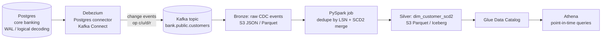

# cdc-debezium-kafka-pipeline

Change data capture (CDC) from a Postgres core-banking database with **Debezium + Kafka**, landed on S3 and
merged into an **SCD Type 2** customer dimension with **PySpark**, queryable in **Athena**.

> 🚧 Work in progress – built milestone by milestone. See [Roadmap](#roadmap).

## Business scenario
A retail bank keeps customer master data (KYC status, risk tier, address, branch) in an OLTP Postgres database.
Compliance and risk teams need to answer *"what was this customer's risk tier and KYC status on the day the loan
was approved?"*, a point-in-time question that a nightly full snapshot cannot answer, because intra-day changes
are lost and history is overwritten.

This project streams every insert/update/delete from Postgres as a change event and keeps a full,
auditable history (SCD Type 2: `valid_from`, `valid_to`, `is_current`) in the lakehouse.

## Architecture


## Generate sample change events (no database needed)
```bash
python -m venv .venv && source .venv/bin/activate
pip install -r requirements.txt
python -m generator.cdc_events --snapshot 20 --changes 100 --duplicate-rate 0.05 --late-rate 0.05
pytest -q
```
Each line is a Debezium-style envelope (`before`, `after`, `source.lsn`, `op` = r/c/u/d). The
`--duplicate-rate` and `--late-rate` flags simulate Kafka's at-least-once delivery and out-of-order
arrival, which the SCD2 job must handle. A seeded sample lives in `data/sample/customers_cdc.jsonl`.

## Run the real CDC stack locally (Docker)
```bash
docker compose -f docker/docker-compose.yml up -d     # Postgres + Kafka (KRaft) + Debezium Connect
./docker/connect/register-connector.sh                 # registers bank-customers-cdc
docker exec -it cdc-postgres psql -U bank -d bank \
  -c "UPDATE customers SET kyc_status='EXPIRED', updated_at=now() WHERE customer_id=2;"
```
Details of each service and connector setting are in [docker/README.md](docker/README.md).

## Land change events in bronze
```bash
# from the generator file (no Docker needed)
python -m ingestion.bronze_writer --from-file data/sample/customers_cdc.jsonl --out data/output/bronze

# from the local Kafka topic
python -m ingestion.bronze_writer --bootstrap localhost:9092 --out data/output/bronze

# or straight to S3
python -m ingestion.bronze_writer --bootstrap localhost:9092 --s3-bucket my-lake-bucket --s3-prefix bronze
```
Output layout:
```
bronze/customers_cdc/event_date=2026-10-01/part-bank.public.customers-0-000000000000.jsonl
bronze/_rejected/customers_cdc/part-...jsonl      # events that failed validation, kept with the error
```
How the bronze writer behaves:
- **Keeps duplicates and out-of-order events.** Bronze is the replayable raw log; dedupe by LSN happens in the SCD2 job.
- **Adds ingestion columns:** `_customer_id`, `_lsn`, `_event_date`, `_kafka_topic`, `_kafka_partition`, `_kafka_offset`, `_ingested_at`.
- **Idempotent landing:** the file name is `topic-partition-first_offset`, so re-running a batch after a crash overwrites the same file.
- **At-least-once:** Kafka offsets are committed only after the batch is written.
- **Deletes** are keyed from the `before` image, because `after` is null for `op=d`.

## Repository layout
```
generator/      synthetic Debezium-style change events (no database needed for tests)
docker/         docker-compose: Postgres + Kafka + Kafka Connect/Debezium
ingestion/      Kafka / file -> bronze landing (local or S3)
transforms/     bronze -> SCD2 silver (PySpark)
quality/        data-quality checks on the dimension
terraform/      S3, Glue, MSK/IAM mapping
tests/          pytest (local Spark, no AWS)
```

## Roadmap
- [x] Repo skeleton, scenario and architecture
- [x] Synthetic CDC event generator
- [x] Local infra (docker-compose: Postgres, Kafka, Debezium)
- [x] Ingestion to bronze
- [ ] SCD2 merge transform
- [ ] Deletes, late / out-of-order events
- [ ] Data-quality checks
- [ ] Unit + integration tests
- [ ] Terraform
- [ ] GitHub Actions CI
- [ ] Design decisions, AWS mapping and FAQ
