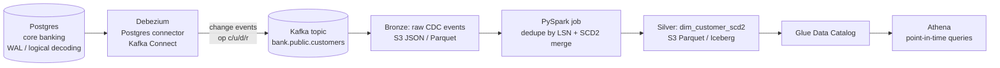
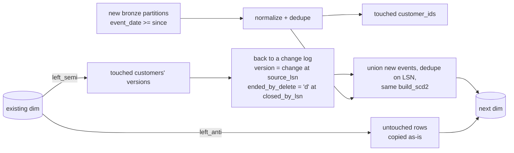

# cdc-debezium-kafka-pipeline

Change data capture (CDC) from a Postgres core-banking database with **Debezium + Kafka**, landed on S3 and
merged into an **SCD Type 2** customer dimension with **PySpark**, queryable in **Athena**.

> 🚧 Work in progress – built milestone by milestone. See [Roadmap](#roadmap).

## Business scenario
A retail bank keeps customer master data (KYC status, risk tier, address, branch) in an OLTP Postgres database.
Compliance and risk teams need to answer *"what was this customer's risk tier and KYC status on the day the loan
was approved?"*, a point-in-time question that a nightly full snapshot cannot answer, because intra-day changes
are lost and history is overwritten.

This project streams every insert/update/delete from Postgres as a change event and keeps a full,
auditable history (SCD Type 2: `valid_from`, `valid_to`, `is_current`) in the lakehouse.

## Architecture


## Generate sample change events (no database needed)
```bash
python -m venv .venv && source .venv/bin/activate
pip install -r requirements.txt
python -m generator.cdc_events --snapshot 20 --changes 100 --duplicate-rate 0.05 --late-rate 0.05
pytest -q        # Spark tests need Java 11 or 17 on PATH
```
Each line is a Debezium-style envelope (`before`, `after`, `source.lsn`, `op` = r/c/u/d). The
`--duplicate-rate` and `--late-rate` flags simulate Kafka's at-least-once delivery and out-of-order
arrival, which the SCD2 job must handle. A seeded sample lives in `data/sample/customers_cdc.jsonl`.

## Run the real CDC stack locally (Docker)
```bash
docker compose -f docker/docker-compose.yml up -d     # Postgres + Kafka (KRaft) + Debezium Connect
./docker/connect/register-connector.sh                 # registers bank-customers-cdc
docker exec -it cdc-postgres psql -U bank -d bank \
  -c "UPDATE customers SET kyc_status='EXPIRED', updated_at=now() WHERE customer_id=2;"
```
Details of each service and connector setting are in [docker/README.md](docker/README.md).

## Land change events in bronze
```bash
# from the generator file (no Docker needed)
python -m ingestion.bronze_writer --from-file data/sample/customers_cdc.jsonl --out data/output/bronze

# from the local Kafka topic
python -m ingestion.bronze_writer --bootstrap localhost:9092 --out data/output/bronze

# or straight to S3
python -m ingestion.bronze_writer --bootstrap localhost:9092 --s3-bucket my-lake-bucket --s3-prefix bronze
```
Output layout:
```
bronze/customers_cdc/event_date=2026-10-01/part-bank.public.customers-0-000000000000.jsonl
bronze/_rejected/customers_cdc/part-...jsonl      # events that failed validation, kept with the error
```
How the bronze writer behaves:
- **Keeps duplicates and out-of-order events.** Bronze is the replayable raw log; dedupe by LSN happens in the SCD2 job.
- **Adds ingestion columns:** `_customer_id`, `_lsn`, `_event_date`, `_kafka_topic`, `_kafka_partition`, `_kafka_offset`, `_ingested_at`.
- **Idempotent landing:** the file name is `topic-partition-first_offset`, so re-running a batch after a crash overwrites the same file.
- **At-least-once:** Kafka offsets are committed only after the batch is written.
- **Deletes** are keyed from the `before` image, because `after` is null for `op=d`.

## Build the SCD2 dimension (PySpark)
```bash
python -m transforms.scd2_merge --bronze data/output/bronze/customers_cdc --out data/output/silver/dim_customer_scd2
```
How [`transforms/scd2_merge.py`](transforms/scd2_merge.py) turns the raw change log into history:

| Step | Why |
|------|-----|
| Take `after` for r/c/u and `before` for d | `after` is null on a delete, so the key and last values come from `before` |
| Dedupe on `(customer_id, lsn)` | Kafka is at-least-once; the LSN is the identity of a change, so replays collapse |
| Order by LSN inside each customer | arrival order and Kafka offset can be wrong after retries; LSN is commit order |
| Drop no-op updates (row hash of tracked columns unchanged) | touching `updated_at` alone should not create a new version |
| `valid_to = lead(change_ts)` over the customer window | a version lives until the next change for that customer |
| Delete events close the open version and are then dropped | a deleted customer has history but no `is_current` row |

Output columns: `customer_sk, customer_id, full_name, email, city, branch_code, risk_tier, kyc_status,
updated_at, valid_from, valid_to (9999-12-31 for open rows), is_current, source_lsn, source_op, closed_by_lsn,
ended_by_delete, row_hash`. `closed_by_lsn` is the LSN of the change that ended a version, and `ended_by_delete`
marks versions closed because the customer row was deleted (account closure), so analysts can tell a closed
customer from a changed one.

Point-in-time question from the scenario, once the table is in the Glue catalog:
```sql
SELECT d.customer_id, d.risk_tier, d.kyc_status
FROM loans l
JOIN dim_customer_scd2 d
  ON d.customer_id = l.customer_id
 AND l.approved_at >= d.valid_from
 AND l.approved_at <  d.valid_to;
```
The full rebuild reads all of bronze. That is simple and always correct, and it stays as the weekly
reconciliation job; the daily job uses the incremental merge below.

## Incremental merge (daily run)
```bash
python -m transforms.scd2_incremental --dim data/output/silver/dim_customer_scd2 \
    --bronze data/output/bronze/customers_cdc --since 2026-10-02 \
    --out data/output/silver/dim_customer_scd2_next
```
[`transforms/scd2_incremental.py`](transforms/scd2_incremental.py) reads only the new `event_date` partitions and
rebuilds history for **just the customers those events touch**:



| Case | What happens |
|------|--------------|
| New update for a customer | current version gets `valid_to`, new version is current |
| Late event (LSN between two existing versions) | slotted in by LSN; the earlier version is re-closed, later versions keep their values because Debezium sends full row images |
| Same batch replayed after a failure | LSN dedupe makes the merge idempotent; output is unchanged |
| Delete in today's batch | open version closed, `ended_by_delete = true`, no current row |
| Delete yesterday, re-create today (same id) | two version chains with a gap between them; the new chain starts with `source_op = c` |
| Late update that lands before an existing delete | inserted before the delete, the delete still closes the chain |

The tests in `tests/test_scd2_incremental.py` compare the incremental result with a full rebuild over the same
events, including a generated two-day stream with duplicates and out-of-order delivery.

One known limit: no-op updates (only `updated_at` changed) are dropped and not kept in the dimension, so a late
event that would turn one of them back into a real change cannot restore it. The weekly full rebuild from bronze
fixes that case. The job also writes to a new path (`_next`) instead of overwriting the table it reads from;
on S3 with Glue the swap is a catalog location update, and with Iceberg it becomes a `MERGE INTO`.

## Data-quality checks on the dimension
```bash
python -m quality.dim_checks --dim data/output/silver/dim_customer_scd2_next \
    --bronze data/output/bronze/customers_cdc --report data/output/dq_report.json
```
A merge can finish without errors and still give wrong point-in-time answers, so
[`quality/dim_checks.py`](quality/dim_checks.py) runs after every build and **before** the new table location is
swapped in. An `error` check failing makes the script exit with code 1, so the orchestrator stops and the old
version of the table stays live; a `warn` is published and reported.

| Check | Severity | Catches |
|-------|----------|---------|
| `not_null_keys` | error | missing customer_id, source_lsn or valid_from |
| `unique_customer_sk` | error | the same customer + LSN written twice |
| `one_current_per_customer` | error | two `is_current` rows for one customer (a point-in-time join would double loans) |
| `valid_window` | error | `valid_from >= valid_to` |
| `current_flag_matches_end` | error | `is_current` disagreeing with the 9999-12-31 open end |
| `no_overlap` | error | next version starting before the previous one ends |
| `no_gap_without_delete` | warn | a hole in the history that no delete explains |
| `deleted_not_current` | error | a closed account still marked current |
| `accepted_values` | warn | risk_tier / kyc_status outside the known codes |
| `reconcile_with_source` | error | current rows vs the latest non-deleted change per customer in bronze |

`reconcile_with_source` compares a hash of the business columns rather than the LSN, because a trailing no-op
update is the newest LSN in the source but correctly never becomes a version. It labels each mismatch as
`missing_in_dim`, `not_live_in_source` or `stale_values`. The report (`dq_report.json`) keeps up to five sample
keys per failed check, which is usually enough to start debugging without re-running Spark.

The dimension is cached once before the checks because every check scans it; on the real table that is
the difference between ten reads of S3 and one.

## Repository layout
```
generator/      synthetic Debezium-style change events (no database needed for tests)
docker/         docker-compose: Postgres + Kafka + Kafka Connect/Debezium
ingestion/      Kafka / file -> bronze landing (local or S3)
transforms/     bronze -> SCD2 silver (PySpark)
quality/        data-quality checks on the dimension
terraform/      S3, Glue, MSK/IAM mapping
tests/          pytest (local Spark, no AWS)
```

## Roadmap
- [x] Repo skeleton, scenario and architecture
- [x] Synthetic CDC event generator
- [x] Local infra (docker-compose: Postgres, Kafka, Debezium)
- [x] Ingestion to bronze
- [x] SCD2 merge transform
- [x] Incremental merge: deletes, re-creates, late / out-of-order events
- [x] Data-quality checks
- [ ] Unit + integration tests
- [ ] Terraform
- [ ] GitHub Actions CI
- [ ] Design decisions, AWS mapping and FAQ
