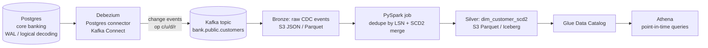
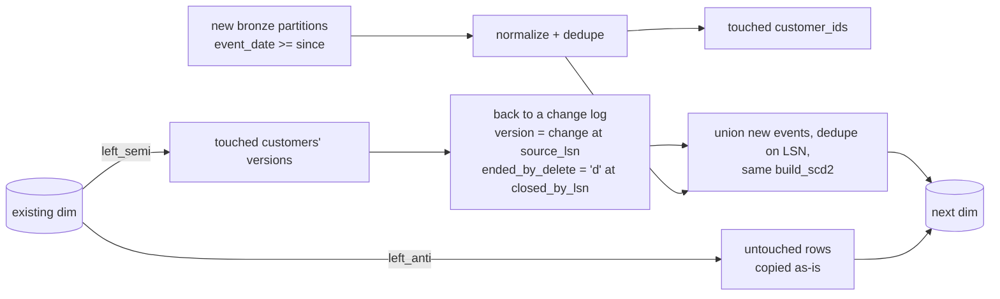
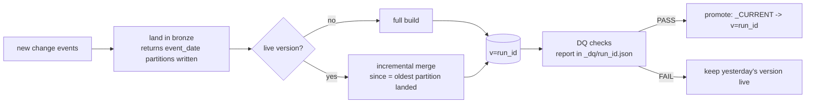
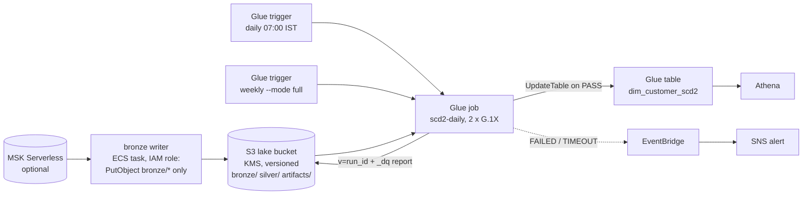

# cdc-debezium-kafka-pipeline

[](https://github.com/bhargavdundu90-dev/cdc-debezium-kafka-pipeline/actions/workflows/ci.yml)

Change data capture (CDC) from a Postgres core-banking database with **Debezium + Kafka**, landed on S3 and
merged into an **SCD Type 2** customer dimension with **PySpark**, queryable in **Athena**.

> 🚧 Work in progress – built milestone by milestone. See [Roadmap](#roadmap).

## Business scenario
A retail bank keeps customer master data (KYC status, risk tier, address, branch) in an OLTP Postgres database.
Compliance and risk teams need to answer *"what was this customer's risk tier and KYC status on the day the loan
was approved?"*, a point-in-time question that a nightly full snapshot cannot answer, because intra-day changes
are lost and history is overwritten.

This project streams every insert/update/delete from Postgres as a change event and keeps a full,
auditable history (SCD Type 2: `valid_from`, `valid_to`, `is_current`) in the lakehouse.

## Architecture


## Generate sample change events (no database needed)
```bash
python -m venv .venv && source .venv/bin/activate
pip install -r requirements.txt
python -m generator.cdc_events --snapshot 20 --changes 100 --duplicate-rate 0.05 --late-rate 0.05
pytest -q        # Spark tests need Java 11 or 17 on PATH
```
Each line is a Debezium-style envelope (`before`, `after`, `source.lsn`, `op` = r/c/u/d). The
`--duplicate-rate` and `--late-rate` flags simulate Kafka's at-least-once delivery and out-of-order
arrival, which the SCD2 job must handle. A seeded sample lives in `data/sample/customers_cdc.jsonl`.

## Run the real CDC stack locally (Docker)
```bash
docker compose -f docker/docker-compose.yml up -d     # Postgres + Kafka (KRaft) + Debezium Connect
./docker/connect/register-connector.sh                 # registers bank-customers-cdc
docker exec -it cdc-postgres psql -U bank -d bank \
  -c "UPDATE customers SET kyc_status='EXPIRED', updated_at=now() WHERE customer_id=2;"
```
Details of each service and connector setting are in [docker/README.md](docker/README.md).

## Land change events in bronze
```bash
# from the generator file (no Docker needed)
python -m ingestion.bronze_writer --from-file data/sample/customers_cdc.jsonl --out data/output/bronze

# from the local Kafka topic
python -m ingestion.bronze_writer --bootstrap localhost:9092 --out data/output/bronze

# or straight to S3
python -m ingestion.bronze_writer --bootstrap localhost:9092 --s3-bucket my-lake-bucket --s3-prefix bronze
```
Output layout:
```
bronze/customers_cdc/event_date=2026-10-01/part-bank.public.customers-0-000000000000.jsonl
bronze/_rejected/customers_cdc/part-...jsonl      # events that failed validation, kept with the error
```
How the bronze writer behaves:
- **Keeps duplicates and out-of-order events.** Bronze is the replayable raw log; dedupe by LSN happens in the SCD2 job.
- **Adds ingestion columns:** `_customer_id`, `_lsn`, `_event_date`, `_kafka_topic`, `_kafka_partition`, `_kafka_offset`, `_ingested_at`.
- **Idempotent landing:** the file name is `topic-partition-first_offset`, so re-running a batch after a crash overwrites the same file.
- **At-least-once:** Kafka offsets are committed only after the batch is written.
- **Deletes** are keyed from the `before` image, because `after` is null for `op=d`.

## Build the SCD2 dimension (PySpark)
```bash
python -m transforms.scd2_merge --bronze data/output/bronze/customers_cdc --out data/output/silver/dim_customer_scd2
```
How [`transforms/scd2_merge.py`](transforms/scd2_merge.py) turns the raw change log into history:

| Step | Why |
|------|-----|
| Take `after` for r/c/u and `before` for d | `after` is null on a delete, so the key and last values come from `before` |
| Dedupe on `(customer_id, lsn)` | Kafka is at-least-once; the LSN is the identity of a change, so replays collapse |
| Order by LSN inside each customer | arrival order and Kafka offset can be wrong after retries; LSN is commit order |
| Drop no-op updates (row hash of tracked columns unchanged) | touching `updated_at` alone should not create a new version |
| `valid_to = lead(change_ts)` over the customer window | a version lives until the next change for that customer |
| Delete events close the open version and are then dropped | a deleted customer has history but no `is_current` row |

Output columns: `customer_sk, customer_id, full_name, email, city, branch_code, risk_tier, kyc_status,
updated_at, valid_from, valid_to (9999-12-31 for open rows), is_current, source_lsn, source_op, closed_by_lsn,
ended_by_delete, row_hash`. `closed_by_lsn` is the LSN of the change that ended a version, and `ended_by_delete`
marks versions closed because the customer row was deleted (account closure), so analysts can tell a closed
customer from a changed one.

Point-in-time question from the scenario, once the table is in the Glue catalog:
```sql
SELECT d.customer_id, d.risk_tier, d.kyc_status
FROM loans l
JOIN dim_customer_scd2 d
  ON d.customer_id = l.customer_id
 AND l.approved_at >= d.valid_from
 AND l.approved_at <  d.valid_to;
```
The full rebuild reads all of bronze. That is simple and always correct, and it stays as the weekly
reconciliation job; the daily job uses the incremental merge below.

## Incremental merge (daily run)
```bash
python -m transforms.scd2_incremental --dim data/output/silver/dim_customer_scd2 \
    --bronze data/output/bronze/customers_cdc --since 2026-10-02 \
    --out data/output/silver/dim_customer_scd2_next
```
[`transforms/scd2_incremental.py`](transforms/scd2_incremental.py) reads only the new `event_date` partitions and
rebuilds history for **just the customers those events touch**:



| Case | What happens |
|------|--------------|
| New update for a customer | current version gets `valid_to`, new version is current |
| Late event (LSN between two existing versions) | slotted in by LSN; the earlier version is re-closed, later versions keep their values because Debezium sends full row images |
| Same batch replayed after a failure | LSN dedupe makes the merge idempotent; output is unchanged |
| Delete in today's batch | open version closed, `ended_by_delete = true`, no current row |
| Delete yesterday, re-create today (same id) | two version chains with a gap between them; the new chain starts with `source_op = c` |
| Late update that lands before an existing delete | inserted before the delete, the delete still closes the chain |

The tests in `tests/test_scd2_incremental.py` compare the incremental result with a full rebuild over the same
events, including a generated two-day stream with duplicates and out-of-order delivery.

One known limit: no-op updates (only `updated_at` changed) are dropped and not kept in the dimension, so a late
event that would turn one of them back into a real change cannot restore it. The weekly full rebuild from bronze
fixes that case. The job also writes to a new path (`_next`) instead of overwriting the table it reads from;
on S3 with Glue the swap is a catalog location update, and with Iceberg it becomes a `MERGE INTO`.

## Data-quality checks on the dimension
```bash
python -m quality.dim_checks --dim data/output/silver/dim_customer_scd2_next \
    --bronze data/output/bronze/customers_cdc --report data/output/dq_report.json
```
A merge can finish without errors and still give wrong point-in-time answers, so
[`quality/dim_checks.py`](quality/dim_checks.py) runs after every build and **before** the new table location is
swapped in. An `error` check failing makes the script exit with code 1, so the orchestrator stops and the old
version of the table stays live; a `warn` is published and reported.

| Check | Severity | Catches |
|-------|----------|---------|
| `not_null_keys` | error | missing customer_id, source_lsn or valid_from |
| `unique_customer_sk` | error | the same customer + LSN written twice |
| `one_current_per_customer` | error | two `is_current` rows for one customer (a point-in-time join would double loans) |
| `valid_window` | error | `valid_from >= valid_to` |
| `current_flag_matches_end` | error | `is_current` disagreeing with the 9999-12-31 open end |
| `no_overlap` | error | next version starting before the previous one ends |
| `no_gap_without_delete` | warn | a hole in the history that no delete explains |
| `deleted_not_current` | error | a closed account still marked current |
| `accepted_values` | warn | risk_tier / kyc_status outside the known codes |
| `reconcile_with_source` | error | current rows vs the latest non-deleted change per customer in bronze |

`reconcile_with_source` compares a hash of the business columns rather than the LSN, because a trailing no-op
update is the newest LSN in the source but correctly never becomes a version. It labels each mismatch as
`missing_in_dim`, `not_live_in_source` or `stale_values`. The report (`dq_report.json`) keeps up to five sample
keys per failed check, which is usually enough to start debugging without re-running Spark.

The dimension is cached once before the checks because every check scans it; on the real table that is
the difference between ten reads of S3 and one.

## Daily run: build, check, promote
```bash
python -m generator.cdc_events --snapshot 20 --changes 250 --duplicate-rate 0.05 --out data/output/in/all.jsonl
python -m pipeline.split_days data/output/in/all.jsonl data/output/in        # one input file per day
python -m pipeline.daily_run --input data/output/in/2026-10-01.jsonl --run-id 2026-10-01
python -m pipeline.daily_run --input data/output/in/2026-10-02.jsonl --run-id 2026-10-02 \
    --start-offset $(wc -l < data/output/in/2026-10-01.jsonl)
```
[`pipeline/daily_run.py`](pipeline/daily_run.py) is what the orchestrator calls once a day:



- Every run writes a new folder `v=<run_id>` and never overwrites one, so yesterday's version is there for rollback.
- `_CURRENT` plays the part of the Glue table location. On AWS, promote is an `UpdateTable` that points the
  table at the new S3 prefix (or an Iceberg commit), so Athena users switch over in one step.
- **Why `since` is not the run date:** a late event is partitioned by the day it happened. If day two's batch
  carries changes committed late on day one, they land in `event_date=2026-10-01`; starting the merge at
  `2026-10-02` would silently skip them. The bronze writer returns the partitions it wrote and the merge starts
  at the oldest one. Re-reading events already in the dimension is safe because of the LSN dedupe.
- A run where every event was rejected skips the build and keeps the live table (`NO_DATA`).
- Local replays continue Kafka offsets with `--start-offset`. Bronze file names use the first offset of a
  batch, and two files both starting at offset 0 would overwrite each other in a shared partition.

## Deploy to AWS (Terraform)
```bash
./scripts/package_glue.sh                       # dist/cdc_pipeline.zip for the Glue job
cd terraform
cp terraform.tfvars.example terraform.tfvars    # region, alert email, MSK on/off
terraform init && terraform plan -out tfplan && terraform apply tfplan
```

| File | What it creates |
|------|-----------------|
| `s3.tf` | one lake bucket (public access blocked, KMS key with rotation, versioning), lifecycle: rejected events expire after 30 days, bronze moves to Standard-IA after 30; Glue script and code zip uploaded from the repo |
| `glue.tf` | Glue database, `dim_customer_scd2` table (Parquet, 17 columns), `bronze_customers_cdc` table with partition projection on `event_date`, the Glue job and two scheduled triggers |
| `iam.tf` | Glue job role: read bronze and code, write only `silver/dim_customer_scd2/*`, `GetTable`/`UpdateTable` only in this database; bronze writer role: `PutObject` on `bronze/*` and MSK read on one topic and one consumer group |
| `msk.tf` | MSK Serverless with IAM auth, behind `create_msk` (default off) |
| `monitoring.tf` | EventBridge rule on Glue job state FAILED/TIMEOUT/STOPPED, SNS topic with optional email |

How the Glue job differs from the local daily run ([`pipeline/glue_job.py`](pipeline/glue_job.py)):
- **Promote is a catalog update.** [`pipeline/glue_catalog.py`](pipeline/glue_catalog.py) reads the table, drops the
  read-only fields that `GetTable` returns and `UpdateTable` rejects, changes only the location and records
  `cdc_live_version` / `cdc_previous_version` as table parameters. `rollback()` points the table back at the
  previous version in one call.
- **Terraform ignores the table location and parameters** (`lifecycle.ignore_changes`), otherwise the next
  `terraform apply` would move the table back to the placeholder and undo the last promote.
- **Lookback instead of "partitions this run landed".** Landing is continuous on AWS, so the job re-reads the last
  `lookback_days` (default 2) `event_date` partitions. Later stragglers are picked up by the weekly `--mode full` run.
- **`max_concurrent_runs = 1` and no automatic retry.** Two runs promoting at the same time would race on
  `UpdateTable`; a failed run is looked at first, then re-run with the same run id (idempotent).
- **Job bookmarks are off.** The job keeps its own state (live version on the table, LSN dedupe), and a bookmark
  would hide the late-event partitions it needs to re-read.
- **A failed DQ check fails the job** (exit code 1), which is what fires the alert; the table is not touched.

The Glue job and catalog code are tested without AWS: `tests/test_glue_catalog.py` runs promote and rollback
against moto, and `tests/test_glue_job.py` runs a full then incremental build under local Spark with the catalog
in moto. `terraform validate` passes with `terraform init -backend=false`.

Rough cost for the dev setup with MSK off: two G.1X workers for a few minutes a day is a few DPU-hours a month,
plus S3 and one KMS key. MSK Serverless is the expensive piece, which is why it is opt-in.

## CI (GitHub Actions)
[`.github/workflows/ci.yml`](.github/workflows/ci.yml) runs on every push to `main` and on pull requests:

| Job | What it does |
|-----|--------------|
| `tests` | Python 3.10 (what Glue 4.0 runs) and 3.11, Temurin Java 17 for local Spark; unit tests, then the integration tests as a separate step, then a smoke run of two daily runs on freshly generated data that must end with `_CURRENT` pointing at day two. JUnit XML and the DQ reports are uploaded as artifacts |
| `glue-package` | builds `dist/cdc_pipeline.zip` and fails if anything other than the four job packages ends up in it (no tests, no generator) |
| `terraform` | `terraform fmt -check`, `init -backend=false`, `validate`; the Glue zip is built first because `s3.tf` hashes it |

Choices worth knowing:
- **No AWS credentials in CI.** S3 and the Glue catalog are mocked with moto, Spark runs `local[2]`. Nothing in
  the pipeline needs a real account to be tested, so a fork's pull request can run the full suite safely.
- **Unit and integration as separate steps.** A red unit step points at one function; a red integration step
  with green units usually means two pieces disagree about a contract (paths, partition names, the promote pointer).
- **`terraform plan` is not in CI.** It needs credentials and state; plan/apply belongs in a deploy workflow with
  OIDC to an IAM role and a manual approval, not in the test pipeline.
- `concurrency` cancels an older run on the same branch, and `SPARK_LOCAL_IP=127.0.0.1` avoids hostname
  resolution problems on hosted runners.

## Design decisions
| Decision | Chosen | Alternatives considered | Why |
|----------|--------|-------------------------|-----|
| Capture method | Debezium log-based CDC (`pgoutput`, logical replication slot) | `updated_at` polling, triggers into an audit table, nightly snapshot | polling misses deletes and every change between two polls; triggers add write cost to the OLTP database; the WAL already has every committed change in order |
| Replica identity | `REPLICA IDENTITY FULL` on `customers` | default (primary key only) | deletes and updates then carry the full `before` image, so a delete can close a version without looking anything up |
| Ordering key | Postgres LSN | Kafka offset, event timestamp, `updated_at` | the LSN is commit order in the source; offsets restart per partition and change on replay, timestamps can tie or drift |
| Bronze format | raw envelopes as JSON lines, partitioned by `event_date`, duplicates kept | dedupe on landing, Parquet with a fixed schema | bronze is the replayable log; if the SCD2 logic has a bug, the dimension is rebuilt from bronze. Deduping early would make that impossible to verify |
| Surrogate key | `sha2(customer_id:lsn)` truncated to 16 hex chars | sequence / `monotonically_increasing_id` | deterministic, so a rebuild or a replay produces the same keys and facts joined on them do not break |
| Change detection | SHA-256 hash of the tracked business columns | compare every column, version on every event | an update that only touches `updated_at` does not create a new version, so history stays readable |
| Daily processing | incremental merge for the customers touched since the oldest landed partition, weekly full rebuild | full rebuild every day, Iceberg `MERGE INTO` only | the daily job reads a few partitions instead of all of bronze; the weekly rebuild repairs the one case the incremental merge cannot (a late event next to a dropped no-op) |
| Publishing | write a new `v=<run_id>` folder, DQ, then switch the Glue table location | overwrite the table in place | readers never see a half-written table, a failed check leaves yesterday live, rollback is one `UpdateTable` |
| Table format | Parquet with catalog swap now, Iceberg as the next step | Iceberg from day one, Hudi | Parquet plus a location swap is easy to run and test locally; the merge logic does not change if the write becomes an Iceberg `MERGE INTO` |
| Orchestration | Glue triggers (daily + weekly full), one concurrent run | Step Functions, MWAA | one job and two schedules do not need a separate orchestrator; Step Functions becomes worth it once other tables depend on this one |

## Local vs AWS
| Piece | Local / tests | AWS |
|-------|---------------|-----|
| Source database | Postgres 16 in docker-compose (`wal_level=logical`) | Amazon RDS / Aurora PostgreSQL with `rds.logical_replication=1` |
| CDC connector | Debezium on Kafka Connect in docker | Debezium on MSK Connect (custom plugin), or DMS for a managed alternative |
| Kafka | Kafka in KRaft mode | MSK Serverless with IAM auth (`msk.tf`, opt-in) |
| Bronze writer | `python -m ingestion.bronze_writer` | same code as an ECS Fargate task with a role limited to `PutObject` on `bronze/*` |
| Storage | `data/output/` folders, moto S3 in tests | S3 lake bucket, KMS encrypted, versioned, lifecycle on bronze |
| Transform | PySpark `local[2]` | Glue 4.0 job (`glue/scd2_daily_job.py`), code shipped as `--extra-py-files` zip |
| Live version pointer | `_CURRENT` file | Glue table location + `cdc_live_version` parameter |
| Catalog | moto Glue | Glue Data Catalog, bronze table with partition projection |
| Query | Spark SQL | Athena |
| Scheduling | `pipeline.daily_run` by hand or cron | Glue triggers: daily 07:00 IST, weekly `--mode full` |
| Alerts | exit code 1 | EventBridge rule on Glue job FAILED/TIMEOUT/STOPPED to SNS |

Things to set on the real database before the connector starts: a dedicated replication user, a publication
limited to the captured tables, and monitoring on the replication slot lag
(`pg_replication_slots`, `confirmed_flush_lsn`). A slot whose consumer is down keeps WAL on disk, so a stopped
connector on RDS ends with a full disk if nobody is alerted.

## Tests
```bash
pytest -q                        # everything (local Spark, no AWS)
pytest -q -m "not integration"   # skip the end-to-end runs
```
| File | Covers |
|------|--------|
| `test_cdc_events.py` | envelope shape per op, LSN/timestamp order, ids, injected duplicates and late events |
| `test_bronze_writer.py` | validation, rejects, bytes and tombstones, file naming per date/partition, UTC dates, commit only after write, offset continuation, S3 via moto |
| `test_scd2_merge.py` | full build: dedupe, ordering, no-ops, deletes |
| `test_scd2_incremental.py` | late events, replays, delete/re-create, parity with full rebuild |
| `test_dim_checks.py` | each DQ check catches its broken case; CLI exit code |
| `test_glue_catalog.py` | Glue promote keeps schema and drops read-only fields, previous version recorded, rollback (moto) |
| `test_glue_job.py` (integration) | Glue argument parsing, lookback window, full then incremental run promoting through the catalog |
| `test_daily_run.py` (integration) | two daily runs through files on disk match a full rebuild, same-day retry is idempotent, failed DQ keeps the old version live, bad-only input skips the build |

## Repository layout
```
generator/      synthetic Debezium-style change events (no database needed for tests)
docker/         docker-compose: Postgres + Kafka + Kafka Connect/Debezium
ingestion/      Kafka / file -> bronze landing (local or S3)
transforms/     bronze -> SCD2 silver (PySpark)
quality/        data-quality checks on the dimension
pipeline/       daily run: land -> build version -> DQ -> promote; Glue job + Glue catalog promote
glue/           script the Glue job runs
scripts/        package_glue.sh (code zip for --extra-py-files)
terraform/      S3 + KMS, Glue catalog/job/triggers, IAM, optional MSK, alerts
tests/          pytest (local Spark, no AWS)
.github/        CI: tests on Python 3.10/3.11, Glue package check, terraform validate
```

## Roadmap
- [x] Repo skeleton, scenario and architecture
- [x] Synthetic CDC event generator
- [x] Local infra (docker-compose: Postgres, Kafka, Debezium)
- [x] Ingestion to bronze
- [x] SCD2 merge transform
- [x] Incremental merge: deletes, re-creates, late / out-of-order events
- [x] Data-quality checks
- [x] Unit + integration tests
- [x] Terraform
- [x] GitHub Actions CI
- [ ] Design decisions, AWS mapping and FAQ
