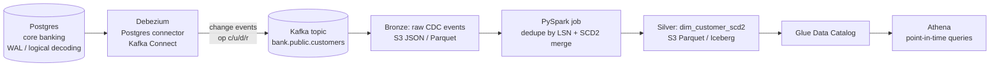

# cdc-debezium-kafka-pipeline

Change data capture (CDC) from a Postgres core-banking database with **Debezium + Kafka**, landed on S3 and
merged into an **SCD Type 2** customer dimension with **PySpark**, queryable in **Athena**.

> 🚧 Work in progress – built milestone by milestone. See [Roadmap](#roadmap).

## Business scenario
A retail bank keeps customer master data (KYC status, risk tier, address, branch) in an OLTP Postgres database.
Compliance and risk teams need to answer *"what was this customer's risk tier and KYC status on the day the loan
was approved?"* — a point-in-time question that a nightly full snapshot cannot answer, because intra-day changes
are lost and history is overwritten.

This project streams every insert/update/delete from Postgres as a change event and keeps a full,
auditable history (SCD Type 2: `valid_from`, `valid_to`, `is_current`) in the lakehouse.

## Architecture


## Generate sample change events (no database needed)
```bash
python -m venv .venv && source .venv/bin/activate
pip install -r requirements.txt
python -m generator.cdc_events --snapshot 20 --changes 100 --duplicate-rate 0.05 --late-rate 0.05
pytest -q
```
Each line is a Debezium-style envelope (`before`, `after`, `source.lsn`, `op` = r/c/u/d). The
`--duplicate-rate` and `--late-rate` flags simulate Kafka's at-least-once delivery and out-of-order
arrival, which the SCD2 job must handle. A seeded sample lives in `data/sample/customers_cdc.jsonl`.

## Planned repository layout
```
generator/      synthetic Debezium-style change events (no database needed for tests)
docker/         docker-compose: Postgres + Kafka + Kafka Connect/Debezium
ingestion/      Kafka -> bronze landing
transforms/     bronze -> SCD2 silver (PySpark)
quality/        data-quality checks on the dimension
terraform/      S3, Glue, MSK/IAM mapping
tests/          pytest (local Spark, no AWS)
```

## Roadmap
- [x] Repo skeleton, scenario and architecture
- [x] Synthetic CDC event generator
- [ ] Local infra (docker-compose: Postgres, Kafka, Debezium)
- [ ] Ingestion to bronze
- [ ] SCD2 merge transform
- [ ] Deletes, late / out-of-order events
- [ ] Data-quality checks
- [ ] Unit + integration tests
- [ ] Terraform
- [ ] GitHub Actions CI
- [ ] Design decisions, AWS mapping and interview Q&A
